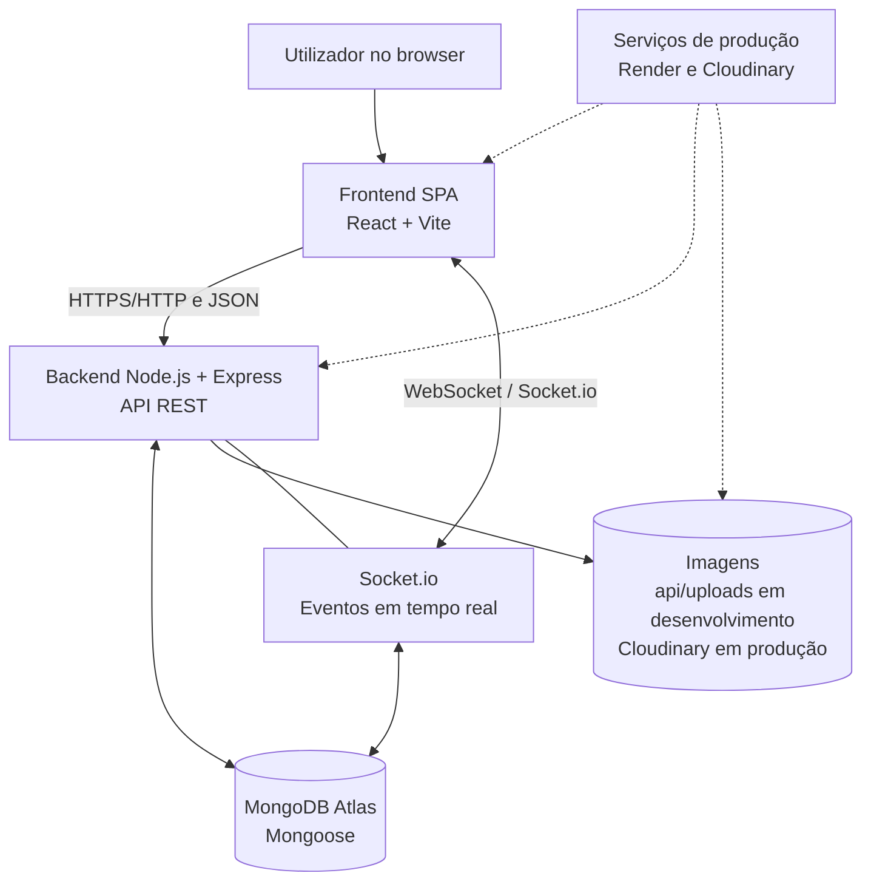
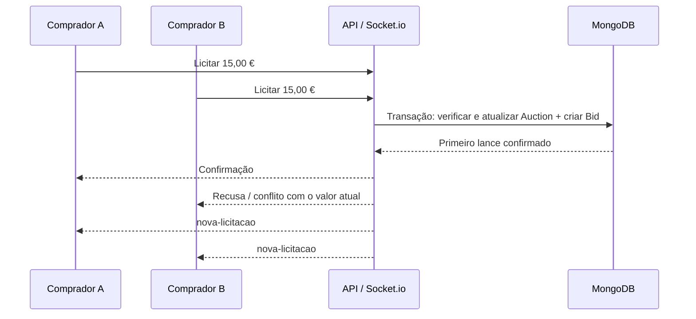

# Do Campo à Mesa

**Relatório técnico — Desenvolvimento Web e para a Cloud**

- **Curso:** Engenharia Informática
- **Instituição:** Escola Superior de Tecnologia e Gestão — Instituto Politécnico de Viana do Castelo (ESTG-IPVC)
- **Ano letivo:** 2026/2027

**Âmbito deste documento:** implementação local, publicação na Cloud e validação

## 1. Introdução

O projeto **Do Campo à Mesa** consiste no desenvolvimento de uma plataforma web destinada a aproximar os produtores locais dos consumidores. A aplicação procura facilitar a divulgação e a comercialização de produtos regionais, disponibilizando um catálogo pesquisável, um processo de encomenda e mecanismos de interação entre compradores e produtores.

O trabalho foi desenvolvido no âmbito da unidade curricular de **Desenvolvimento Web e para a Cloud** e pretende integrar, numa única solução, as principais tecnologias estudadas: uma *Single Page Application* (SPA), uma API REST, persistência numa base de dados NoSQL, autenticação e autorização, comunicação em tempo real e preparação para alojamento na Cloud.

A plataforma contempla três perfis de utilizador:

- **Comprador:** consulta e pesquisa produtos, gere um carrinho, efetua e acompanha encomendas, avalia produtos e produtores após a entrega e participa em leilões.
- **Produtor:** cria uma conta sujeita a validação, edita o seu perfil público, gere produtos, fotografias e stock, acompanha encomendas recebidas e cria leilões.
- **Administrador:** aprova ou rejeita produtores, consulta indicadores da plataforma e modera avaliações denunciadas.

Além das operações habituais de um marketplace, o projeto inclui **leilões em tempo real**, nos quais os participantes acompanham as licitações e o tempo restante sem recarregar a página. O fecho de um leilão com vencedor origina automaticamente uma encomenda.

As funcionalidades foram implementadas e testadas em ambiente local, com utilização do **MongoDB Atlas** como base de dados. A secção 8 descreve a publicação na Cloud e a respetiva validação.

## 2. Arquitetura

A aplicação segue uma arquitetura **cliente–servidor**, com separação entre apresentação, lógica de negócio e persistência. O frontend é uma SPA em React; o backend é uma API em Node.js e Express; e o MongoDB Atlas assegura o armazenamento dos dados. O Socket.io acrescenta comunicação bidirecional em tempo real.

### 2.1. Diagrama de componentes



*Figura 1 — Arquitetura lógica do sistema. Em produção, o Render aloja o frontend e a API, e o Cloudinary armazena as fotografias. O diretório `api/uploads` corresponde ao modo local de desenvolvimento.*

O frontend comunica com a API através de pedidos HTTP, recebendo respostas normalmente em JSON. As operações que exigem autenticação incluem o token JWT. A comunicação Socket.io é utilizada em funcionalidades que beneficiam de atualizações imediatas, como licitações, presença nas salas e notificações.

O backend concentra as regras de negócio: valida os dados, verifica as permissões, executa operações sobre os modelos Mongoose e controla a consistência das transações. Esta organização impede que a segurança ou a decisão de aceitar uma licitação dependam exclusivamente do browser.

### 2.2. Responsabilidades dos componentes

| Componente | Tecnologia | Responsabilidade |
|---|---|---|
| SPA | React, Vite, JavaScript, Bootstrap e SASS | Interface, navegação, formulários e apresentação dos dados |
| API REST | Node.js e Express | Recursos, validação, autenticação e regras de negócio |
| Servidor de eventos | Socket.io integrado no backend | Salas de leilão, licitações, presença e notificações |
| Persistência | MongoDB Atlas e Mongoose | Utilizadores, produtos, encomendas, leilões, licitações e avaliações |
| Imagens | Diretório local `api/uploads` em desenvolvimento e Cloudinary em produção | Armazenamento e disponibilização das fotografias dos produtos |
| Alojamento | Render Static Site e Render Web Service | Publicação do frontend, da API e do Socket.io |

Em desenvolvimento, o frontend é executado em `http://localhost:5173` e a API em `http://localhost:3000`. Os endereços públicos constam da secção 8.2.

O armazenamento local permitiu implementar e testar o envio de fotografias durante o desenvolvimento. Na aplicação publicada, o Cloudinary mantém os ficheiros disponíveis após reinícios da API, e o MongoDB guarda os respetivos URLs HTTPS.

## 3. Frontend e SPA

### 3.1. Framework e organização

O frontend foi desenvolvido com **React**, utilizando **Vite** para a configuração e execução do projeto. A escolha do React permitiu construir a interface com componentes reutilizáveis e atualizar partes da página em função das alterações de estado, sem recarregamentos completos a cada operação.

A aplicação é uma **SPA (Single Page Application)**: a navegação entre áreas como catálogo, encomendas, leilões e painéis de gestão é tratada no frontend, através de rotas, enquanto os dados são obtidos da API.

A organização inclui páginas e componentes para responsabilidades distintas, por exemplo:

- **Páginas:** catálogo, produtor público, login, registo, encomendas, sala de leilão e painéis do produtor e administrador.
- **Componentes reutilizáveis:** cartões de produto e leilão, formulário de finalização do carrinho, painel de licitação, barra de navegação e avisos de notificações.
- **Hooks próprios:** carregamento de dados da API, gestão da sala de leilão, contagem sincronizada e atualização periódica das listagens visíveis.

A separação entre páginas, componentes, hooks e serviços HTTP facilita a manutenção e evita concentrar toda a lógica numa única interface.

### 3.2. Gestão de estado e comunicação com a API

A aplicação utiliza **Context API** e hooks do React para partilhar informação entre componentes:

- **`AuthContext`:** guarda o estado da autenticação, valida a sessão junto da API, trata o login e logout e fornece a identidade e o papel do utilizador.
- **`CarrinhoContext`:** gere os artigos selecionados, quantidades e totais, com persistência local do carrinho.
- **`SocketContext`:** mantém uma ligação Socket.io partilhada por sessão autenticada e por aba, evitando criar uma nova ligação a cada página.

O módulo de cliente HTTP centraliza pedidos à API, inclusão do JWT e tratamento de erros. Os dados apresentados no catálogo, nas encomendas e nos painéis são obtidos dos serviços reais: os mecanismos anteriores de dados simulados foram removidos.

Quando existem eventos em tempo real, os componentes atualizam o estado apresentado. Em caso de desconexão ou regresso a uma aba, são efetuadas novas consultas REST para recuperar o estado persistido no servidor. Algumas listagens consultam a API periodicamente enquanto estão visíveis, evitando manter indefinidamente informação desatualizada.

### 3.3. Navegação e proteção de rotas

O encaminhamento de páginas é realizado no frontend, com rotas públicas e rotas protegidas. O acesso às áreas de produtor e administrador depende do perfil autenticado.

Uma sessão guardada no browser não é suficiente, por si só, para disponibilizar conteúdo protegido. Após um *refresh*, o frontend valida a sessão na API e aguarda o resultado. Caso a API esteja temporariamente indisponível, apresenta um estado de erro e permite repetir a verificação, em vez de assumir que a sessão continua válida.

A proteção efetiva dos dados é feita também no backend: esconder uma página ou botão no React não substitui a verificação de permissões nas rotas da API.

### 3.4. Interface responsiva e abordagem Mobile First

A interface utiliza **Bootstrap** e **SASS**, procurando adaptar conteúdos, cartões, formulários e painéis a diferentes larguras de ecrã. O desenho favorece a organização em blocos e a reorganização dos elementos em dispositivos mais estreitos, de acordo com uma abordagem **Mobile First**.

A responsividade foi verificada em larguras de **320 px, 390 px e 1440 px**, representando telemóveis compactos, telemóveis e desktop. As notificações, por exemplo, foram adaptadas para uma área rolável em ecrãs pequenos, de modo a não impedir o acesso a controlos essenciais.

O projeto beneficia das classes e dos *breakpoints* responsivos do Bootstrap e de estilos SASS personalizados. Os valores exatos de cada media query podem ser consultados no código de estilos; não é necessário assumir que todos os componentes utilizam os mesmos pontos de quebra.

## 4. API REST e documentação

A API foi desenvolvida em **Node.js e Express**, com rotas organizadas por recurso. Os endpoints disponibilizam os dados e as operações do marketplace, aplicando validações e controlos de acesso no servidor.

A base local da API é `http://localhost:3000/api`. A documentação interativa está disponível, durante a execução local do backend, em:

**Swagger UI:** `http://localhost:3000/api-docs`

A especificação é mantida em **OpenAPI 3.0.3**, no ficheiro `api/openapi.yaml`. Como foram adicionadas funcionalidades durante a revisão final, a documentação deverá ser novamente confrontada com a versão atual da API antes da entrega definitiva.

### 4.1. Recursos e operações principais

| Recurso | Exemplos de endpoints | Finalidade |
|---|---|---|
| Serviço | `GET /api/health` | Verificar o estado da API |
| Autenticação | `POST /api/auth/registo`, `POST /api/auth/login`, `GET /api/auth/eu` | Registo, login e consulta da sessão |
| Produtos | `GET /api/products`, `POST /api/products`, `GET/PUT/DELETE /api/products/:id` | Catálogo e gestão de produtos |
| Fotografias | `POST /api/products/:id/imagem` | Upload da imagem de um produto |
| Produtores | `GET /api/producers`, `GET /api/producers/:id`, `PATCH /api/producers/:id` | Consulta e edição autorizada do perfil público |
| Encomendas | `GET /api/orders`, `POST /api/orders`, `GET /api/orders/:id`, `PATCH /api/orders/:id/estado` | Checkout, consulta e atualização de estados |
| Leilões | `GET /api/auctions`, `POST /api/auctions`, `GET /api/auctions/:id`, `GET /api/auctions/:id/bids` | Listagem, criação, detalhe e histórico |
| Avaliações | Rotas em `/api/reviews` | Consulta, publicação e denúncia de avaliações |
| Administração | Rotas em `/api/admin` | Indicadores, aprovação de produtores e moderação |

Os verbos HTTP representam a intenção da operação: **GET** para consulta, **POST** para criação ou submissão, **PUT/PATCH** para atualização e **DELETE** para remoção. A API utiliza códigos de estado adequados às operações, nomeadamente:

- **200 OK:** consulta ou alteração concluída com resposta.
- **201 Created:** recurso criado, por exemplo uma encomenda ou avaliação.
- **204 No Content:** operação concluída sem corpo de resposta, quando aplicável.
- **400 Bad Request:** dados inválidos ou incompletos.
- **401 Unauthorized:** autenticação inexistente ou inválida.
- **403 Forbidden:** utilizador autenticado sem permissão.
- **404 Not Found:** recurso inexistente.
- **409 Conflict:** conflito de estado ou concorrência, como stock insuficiente ou avaliação duplicada.
- **500 Internal Server Error:** erro inesperado do servidor.

A utilização de **JSON** nas operações REST facilita a integração com o React. O envio de fotografias constitui uma exceção: utiliza **`multipart/form-data`**, de acordo com a rota de upload.

### 4.2. Consistência no checkout

O checkout agrupa os artigos por produtor e cria uma encomenda por produtor. Para evitar descontos de stock sem encomendas correspondentes, a reserva das quantidades e a gravação de todas as encomendas da compra são realizadas **na mesma transação MongoDB**. Se uma operação falhar antes da confirmação, a transação é revertida.

O sistema inclui também uma **`Idempotency-Key`** enviada pelo frontend. Se um pedido for repetido com a mesma chave e os mesmos dados, o backend pode devolver as encomendas já criadas, sem voltar a descontar o stock. Esta proteção depende da reutilização da chave: após abandonar ou recarregar o formulário, pode ser gerada outra chave para uma nova tentativa, o que constitui uma limitação conhecida.

As notificações associadas à compra são emitidas apenas depois de confirmada a transação, evitando anunciar encomendas que não ficaram persistidas.

## 5. Modelo de dados

O projeto utiliza **MongoDB Atlas**, uma base de dados documental NoSQL, e **Mongoose**, que permite definir modelos, validações e relações entre documentos. A estrutura foi organizada em coleções correspondentes aos principais conceitos de negócio.

### 5.1. Coleções principais

| Modelo / coleção | Informação representada |
|---|---|
| **User** | Compradores, produtores e administradores; autenticação, papel e dados de perfil |
| **Product** | Produtos, preço, stock, categoria, descrição, fotografia e produtor |
| **Order** | Encomendas, comprador, produtor, linhas, total, estado e receção |
| **Checkout** | Identificação de tentativas de checkout e respetivas encomendas, para idempotência |
| **Auction** | Produto/lote, produtor, datas, estado, preço, incremento e vencedor |
| **Bid** | Licitações, valor, comprador, leilão e instante da licitação |
| **Review** | Avaliações de produtos e produtores, classificação, comentário e moderação |

### 5.2. Embedding e referências

A modelação combina **documentos incorporados (*embedding*)** e **referências (*linking*)** em função da forma como os dados são consultados e atualizados.

Nas **encomendas**, as linhas com os artigos, quantidades, unidades e preços são armazenadas no próprio documento da encomenda. Esta opção permite consultar e apresentar uma compra como uma unidade lógica e conservar os valores praticados no momento da compra, mesmo que o preço atual do produto venha a mudar.

Já as relações entre **produtores e produtos**, **leilões e licitações** e **utilizadores e encomendas** utilizam referências entre documentos. Por exemplo, as licitações são guardadas separadamente do leilão, porque constituem um histórico que cresce ao longo do tempo e que pode ser consultado e ordenado independentemente do estado atual do lote.

As avaliações também são documentos próprios, possibilitando a sua consulta por produtor ou produto, bem como os mecanismos de denúncia e moderação, sem incorporar listas extensas no documento do produtor.

### 5.3. Índices e integridade

Os índices e as restrições apoiam a pesquisa, a unicidade e a consistência dos dados. Entre os mecanismos relevantes da implementação destacam-se:

- **Identificação de utilizadores:** prevenção de contas duplicadas através das regras de unicidade aplicadas ao registo.
- **Avaliações:** verificação de elegibilidade e prevenção de avaliações duplicadas para a mesma compra e alvo.
- **Checkout:** associação de uma chave de idempotência a um pedido do comprador, evitando repetir a mesma compra quando a chave é reutilizada.
- **Encomendas de leilão:** índice único parcial **`uma_encomenda_por_leilao`**, que impede associar duas encomendas ao mesmo leilão sem restringir as encomendas normais.
- **Licitações:** atualização condicional e transacional do leilão, para que os valores e o histórico permaneçam consistentes em situações concorrentes.

O comportamento dos índices foi validado em testes com instâncias de MongoDB configuradas como *replica set*, necessárias para suportar as transações utilizadas.

### 5.4. Exemplos de pesquisas

Os seguintes exemplos ilustram consultas típicas no MongoDB. Os nomes concretos dos campos devem ser confirmados no código dos modelos caso a estrutura seja posteriormente alterada.

**Produtos disponíveis de um produtor:**

```javascript
// Exemplo conceptual: referência ao produtor e stock positivo
db.products.find({
  produtor: ObjectId("ID_DO_PRODUTOR"),
  stock: { $gt: 0 }
});
```

**Encomendas de um comprador, por ordem cronológica:**

```javascript
db.orders.find({
  comprador: ObjectId("ID_DO_COMPRADOR")
}).sort({ createdAt: -1 });
```

**Histórico de licitações de um leilão:**

```javascript
db.bids.find({
  leilao: ObjectId("ID_DO_LEILAO")
}).sort({ createdAt: -1 }).limit(20);
```

Na aplicação, estas consultas são executadas através da API e dos modelos Mongoose, que também verificam o papel e a titularidade do utilizador antes de devolver informação privada.

## 6. Segurança

A segurança da plataforma é aplicada em diferentes níveis: autenticação, autorização, validação de dados, proteção de credenciais e consistência das operações.

### 6.1. Autenticação com JWT

O utilizador inicia sessão através da API, que valida as credenciais e devolve um **JSON Web Token (JWT)**. O frontend apresenta esse token nos pedidos autenticados. O backend verifica a assinatura, o algoritmo e a validade temporal do token, bem como a identidade e as permissões associadas.

As ligações Socket.io também são autenticadas. A sessão é verificada antes de permitir acesso a salas e operações privadas, e a expiração do JWT é tratada mesmo quando a ligação já se encontra aberta.

Após recarregar a SPA, o frontend valida a sessão junto de `GET /api/auth/eu` antes de apresentar páginas protegidas. Uma falha temporária de rede não equivale automaticamente a uma autenticação válida; a aplicação mostra um estado de indisponibilidade e permite repetir a verificação.

### 6.2. Autorização por papéis

O sistema diferencia **comprador**, **produtor** e **administrador**. As permissões são verificadas nas rotas do backend e não apenas nos componentes do React.

Um comprador não pode alterar produtos de outro utilizador ou aceder a dados administrativos. Um produtor apenas pode gerir os seus recursos e, para realizar operações reservadas, necessita de uma conta aprovada. O administrador dispõe das operações de validação de produtores e moderação.

A validação de produtores distingue os estados **pendente**, **aprovado** e **rejeitado**. As decisões são guardadas de forma a impedir que dois administradores confirmem resultados incompatíveis para a mesma conta.

### 6.3. Proteção de palavras-passe e validação

As palavras-passe não são armazenadas em texto simples. O backend utiliza **bcrypt** para produzir o respetivo *hash* e comparar as credenciais apresentadas no login.

As entradas recebidas pela API são validadas de acordo com a operação: campos obrigatórios, formatos, valores monetários representáveis em cêntimos, stock inteiro e não negativo, permissões de titularidade e tipos de ficheiros admitidos no upload.

### 6.4. HTTPS e gestão de segredos

Em desenvolvimento local, a aplicação utiliza endereços `localhost` com HTTP. **Na publicação em produção**, a comunicação pública deverá utilizar **HTTPS** e, para os sockets, uma ligação segura compatível com WebSocket (**WSS**). A configuração será realizada no âmbito do ponto 8.

Credenciais de acesso ao MongoDB, segredos utilizados na assinatura dos JWT e outras configurações sensíveis são mantidos em **variáveis de ambiente**, fora do repositório Git. Os ficheiros `.env` locais são ignorados pelo controlo de versões; os ficheiros `.env.example` devem conter apenas exemplos sem credenciais reais.

Embora estas medidas aumentem a segurança, a aplicação deverá continuar sujeita a verificações próprias de um ambiente público, incluindo gestão segura de segredos, configuração de CORS, proteção de uploads e atualização de dependências.

## 7. Tempo real e consistência dos leilões

Os leilões constituem uma das funcionalidades centrais do projeto. Permitem que um produtor coloque um lote disponível durante um intervalo definido e que vários compradores concorram através de licitações, acompanhando as alterações em tempo real.

### 7.1. Salas, eventos e presença

A comunicação em tempo real é assegurada pelo **Socket.io**. Cada ligação autenticada pode integrar uma sala pessoal, identificada por `user:<id>`, utilizada para notificações privadas, e uma sala de leilão, identificada por `leilao:<id>`.

Ao entrar numa sala, o servidor valida o identificador e a existência do leilão e envia o estado relevante, incluindo a hora do servidor, os dados do lote e as licitações recentes. A presença é atualizada quando os participantes entram, saem ou perdem a ligação. Entradas repetidas não devem aumentar indevidamente o número de participantes.

Os eventos envolvidos incluem:

| Evento / mecanismo | Finalidade |
|---|---|
| `estado` | Sincronizar o leilão, a hora do servidor e o histórico recente |
| Licitação por Socket.io com *acknowledgement* | Enviar um lance e receber confirmação ou recusa |
| `nova-licitacao` | Informar os participantes sobre uma licitação aceite |
| `aberto` | Informar que o leilão passou a ativo |
| `terminado` | Informar que o leilão terminou |
| `leilao-ganho` | Notificar privadamente o comprador vencedor |
| `leilao-terminado` | Notificar o produtor sobre o resultado |

O frontend mantém uma ligação partilhada por sessão e atualiza a interface sem recarregar a página. A contagem decrescente é sincronizada com a hora recebida do servidor, utilizando depois um relógio monotónico no browser para reduzir o impacto de alterações na hora local.

O **servidor é sempre a autoridade final**: a contagem visual não decide se uma licitação é aceite. Em caso de perda de ligação, a aplicação consulta novamente a API REST, recuperando o estado persistido em vez de assumir que recebeu todos os eventos entretanto emitidos.

### 7.2. Validação das licitações

Uma licitação apenas pode ser apresentada por um **comprador autenticado**. O backend identifica o comprador a partir do JWT, sem confiar num identificador enviado pelo browser. Antes de aceitar o lance, verifica:

- Se o leilão existe, está **ativo** e ainda não ultrapassou o prazo.
- Se o utilizador tem permissão para licitar.
- Se o valor é válido e respeita o incremento mínimo.
- Se o lance é igual ou superior ao mínimo calculado a partir do valor atual e do incremento exigido.

Os cálculos monetários são efetuados em **cêntimos inteiros**, evitando erros de precisão associados à representação de números decimais em ponto flutuante.

### 7.3. Licitações simultâneas e atomicidade

O principal problema de concorrência surge quando dois compradores tentam licitar o mesmo montante ao mesmo tempo. Se ambos consultassem o valor anterior e gravassem o novo valor sem coordenação, poderiam ser aceites dois lances incompatíveis.

A implementação resolve este problema com uma **atualização condicional atómica do documento `Auction`**, executada dentro de uma **transação MongoDB**, juntamente com a criação do documento `Bid`. A condição da atualização volta a verificar o estado, o prazo e o valor do leilão no momento da escrita. Assim, um segundo lance incompatível com o novo estado não pode ser aceite com base num valor desatualizado.

**Exemplo:** se o valor atual é 10,00 € e o incremento mínimo é 5,00 €, dois compradores podem tentar licitar 15,00 € simultaneamente. Apenas um desses lances deve ser confirmado; o outro é recusado ou reavaliado face ao valor que passou a estar em vigor.



*Figura 2 — Exemplo conceptual de concorrência entre dois lances iguais. A ordem de chegada não constitui uma garantia para um comprador específico; a base de dados determina qual operação é confirmada.*

A transação garante também que, se a gravação de `Bid` falhar, a alteração do valor e do contador de licitações em `Auction` é revertida. O evento `nova-licitacao` e a confirmação de sucesso só são emitidos **após o commit**. Falhas de emissão não devem transformar uma licitação já persistida numa falsa recusa.

A suite automatizada usou dois clientes Socket.io autenticados, ligados a uma única instância da API. Nos três ensaios com lances concorrentes do mesmo valor, apenas um lance foi aceite em cada leilão. O valor atual, o contador e o histórico permaneceram consistentes, conforme os resultados da secção 8.3.

### 7.4. Abertura, fecho automático e encomenda do vencedor

O backend executa um **serviço de ciclo de leilões** que verifica periodicamente os prazos. Quando chega a hora de início, um leilão agendado passa a ativo; quando chega o fim, um leilão ativo passa a terminado.

Se existirem licitações, o sistema identifica o vencedor confirmado e cria uma **encomenda de origem `leilao`**, com uma unidade do tipo **lote** e o valor final da licitação. Se não houver licitações, o leilão termina sem vencedor e sem criar encomenda.

O fecho, a criação da encomenda e a associação ao leilão são realizados numa **transação**. A execução é protegida contra repetições, incluindo através de um índice único parcial que impede criar duas encomendas para o mesmo leilão. A licitação e o fecho disputam o estado do mesmo documento, evitando confirmar um lance incompatível com o encerramento.

O ciclo é ativado através da variável de ambiente **`CICLO_LEILOES_ATIVO=true`**. Foi validado pela suite automatizada em ambiente local e ativado no Web Service do Render. O autor confirmou manualmente o fecho automático na aplicação publicada, em leilões com e sem licitações.

### 7.5. Recuperação e limitações atuais

A aplicação foi validada com **uma instância da API**. O adaptador Socket.io utilizado distribui os eventos apenas dentro dessa instância. A publicação com várias instâncias exigiria um mecanismo partilhado de distribuição de eventos, conforme discutido na secção 9.

As notificações são **transitórias**: não constituem um histórico persistente nem notificações *push* do sistema operativo. Depois de uma desconexão, as páginas podem recuperar os dados atuais por REST, mas não reproduzem obrigatoriamente os avisos que não foram recebidos.

Os testes de integração confirmaram o funcionamento do fecho automático, a criação de **uma única encomenda** para o vencedor, a ausência de encomenda num leilão sem licitações, a atualização das salas por Socket.io e a recuperação do estado após falhas de ligação.

## 8. Deployment na Cloud

As secções 1 a 7 documentam o desenvolvimento e a validação local. Esta secção descreve a publicação e a configuração final na Cloud.

### 8.1. Serviços e modelos de fornecimento

| Serviço | Modelo e justificação | Papel na aplicação |
| --- | --- | --- |
| Render Web Service | PaaS. O fornecedor gere o ambiente de execução, a publicação e a terminação TLS. O projeto fornece o código e a configuração da API. | Executa Node.js, Express e Socket.io na mesma instância, incluindo o ciclo automático dos leilões. |
| Render Static Site | Alojamento estático gerido, no âmbito de uma oferta PaaS. O fornecedor compila a SPA e distribui os artefactos por CDN. | Serve a interface React/Vite por HTTPS e encaminha as rotas da SPA para `index.html`. |
| MongoDB Atlas | DBaaS. O fornecedor opera o cluster, enquanto a aplicação define o modelo, as consultas, os índices e as transações. | Persiste os dados da aplicação, incluindo produtos, encomendas, leilões e licitações. |
| Cloudinary | Serviço gerido de armazenamento e distribuição de conteúdos multimédia, consumido como SaaS através de uma API. | Guarda e serve as fotografias. O MongoDB conserva o URL HTTPS de cada fotografia. |
| GitHub | SaaS de alojamento de repositórios Git. | Mantém o histórico de versões e fornece o repositório e a branch de origem à integração de publicação do Render. |

A SPA consulta a API por HTTPS e estabelece a ligação Socket.io com a mesma origem da API. Quando o transporte é WebSocket, a ligação usa WSS. A API comunica com o Atlas e envia as fotografias diretamente ao Cloudinary. O navegador obtém as imagens a partir do URL público devolvido pelo backend. [Render WebSockets](https://render.com/docs/websocket) · [Render Static Sites](https://render.com/docs/static-sites)

### 8.2. Publicação e configuração

A aplicação e a API foram publicadas como dois serviços do mesmo repositório GitHub. Para reproduzir a publicação, a API usa `npm ci` e `npm start` a partir de `api/`. O frontend usa `npm ci` e `npm run build` a partir de `web/` e publica `dist/`. O *rewrite* para `index.html` permite abrir rotas internas diretamente, como `/leiloes`. O endpoint `/api/health` verifica se o processo HTTP responde. [Render Monorepo Support](https://render.com/docs/monorepo-support)

O frontend é compilado com `VITE_API_URL` a apontar para a origem pública da API. A configuração de CORS usa `CLIENT_URL` com a origem HTTPS exata da SPA, incluindo o esquema e sem barra final. A mesma origem é usada no Express e no Socket.io. No Web Service, `MONGODB_URI`, `JWT_SECRET` e `CLOUDINARY_URL` são segredos do ambiente. `NODE_ENV=production` e `IMAGENS_ARMAZENAMENTO=cloudinary` selecionam a configuração de produção. O ciclo foi ativado com `CICLO_LEILOES_ATIVO=true`. A execução local sobre o mesmo Atlas deve manter o ciclo desativado para concentrar as transições e os avisos na instância publicada.

A configuração de CORS foi confirmada com um pedido *preflight* do frontend publicado. As referências antigas a fotografias locais dependiam do disco e do endereço da API de desenvolvimento. Os novos carregamentos resolvem esse problema ao guardar o ficheiro no Cloudinary e o URL HTTPS em `imagemUrl`. As referências antigas só passam a funcionar na Cloud após novo carregamento da fotografia correspondente. O código não executa uma migração automática.

| Recurso | URL |
| --- | --- |
| Frontend | [Aplicação Do Campo à Mesa](https://do-campo-a-mesa-web-d1xc.onrender.com) |
| API REST | [Origem da API](https://do-campo-a-mesa-342d.onrender.com), com os recursos sob `/api` |
| Swagger | [Swagger UI](https://do-campo-a-mesa-342d.onrender.com/api-docs/) |


### 8.3. Testes e validação

A validação da aplicação foi realizada em dois ambientes: na Cloud, através de testes manuais sobre os serviços publicados no Render, e localmente, através de uma suite automatizada de testes de ponta a ponta da API REST e do Socket.io.

#### Testes na Cloud

As verificações públicas devolveram HTTP `200` para o frontend, `/api/health`, a Swagger UI e a listagem de leilões. A rota direta `/leiloes` apresentou corretamente a SPA. O pedido *preflight* do login devolveu HTTP `204`, confirmando a configuração de CORS. A ligação WebSocket segura (WSS) e o transporte *polling* alcançaram a autenticação Socket.io, sendo recusadas as ligações sem JWT válido.

Foi também confirmado manualmente o upload de fotografias através da aplicação publicada. A imagem enviada foi armazenada no Cloudinary e apresentada corretamente no catálogo, através de um URL HTTPS. Foram ainda testados leilões com e sem licitações, verificando-se o seu encerramento automático e o comportamento correspondente a cada cenário.

#### Testes automatizados de ponta a ponta

Foi implementada uma suite de testes no ficheiro `api/test/e2e.js`, executada através dos comandos:

```bash
cd api
npm test
```

A execução utilizou Node.js `22.21.0`, MongoDB `8.2.1` num replica set temporário local e Socket.io sobre WebSocket. Os testes recorreram a `fetch` para a API REST e a `socket.io-client` para a comunicação em tempo real, sem modificar os dados do MongoDB Atlas.

Foram verificadas a autenticação JWT, permissões por papel, gestão de produtos, pesquisa e filtros, checkout transacional, idempotência, consistência do stock, encomendas, avaliações, denúncias, notificações privadas, salas Socket.io e ciclo automático dos leilões.

A suite foi executada duas vezes com sucesso, obtendo **25 verificações aprovadas e 0 falhadas** em cada execução. A execução realizada no terminal do autor apresentou a seguinte saída representativa:

```text
PASS — Concorrência 1/3: dois lances de 105 €, uma aceitação e estado igual nos clientes e no MongoDB
PASS — Concorrência 2/3: dois lances de 105 €, uma aceitação e estado igual nos clientes e no MongoDB
PASS — Concorrência 3/3: dois lances de 105 €, uma aceitação e estado igual nos clientes e no MongoDB
PASS — Rajada de dez lances: acknowledgements aceites, Bid, incremento e Auction consistentes
PASS — Fecho automático anuncia vencedor e cria uma única encomenda privada, mesmo após novo ciclo
PASS — Leilão sem lances termina sem vencedor, licitações ou encomenda

Resumo: 25 aprovadas, 0 falhadas (25 executadas).
```

#### Teste de licitações simultâneas

O teste de concorrência teve como objetivo demonstrar que duas licitações submetidas simultaneamente não provocam inconsistências no estado de um leilão.

Foram utilizados dois compradores autenticados, que enviaram, através de `Promise.all`, licitações simultâneas de `105 €` para um leilão com preço inicial de `100 €` e incremento mínimo de `5 €`.

O ensaio foi repetido em três leilões independentes. Em todas as execuções, apenas uma licitação foi aceite. A segunda foi recusada com a mensagem `Licitação mínima: 110,00 €`, pois o valor mínimo já tinha sido atualizado após a primeira confirmação.

A consulta à base de dados confirmou os seguintes resultados em cada repetição:

| Elemento verificado | Resultado observado |
| --- | --- |
| Licitações submetidas | 2, ambas de 105 € |
| Licitações aceites | 1 |
| Licitações recusadas | 1 |
| `Auction.numLicitacoes` | 1 |
| Documentos `Bid` criados | 1 |
| `Auction.licitacaoAtual.valor` | 105 € |
| Comprador líder | Correspondente à licitação aceite |
| Estado dos clientes Socket.io | Ambos receberam o mesmo lance confirmado |

A consistência é garantida através de atualizações condicionais e transações MongoDB. A atualização do documento `Auction` e a inserção do respetivo `Bid` são realizadas na mesma transação. Desta forma, duas operações concorrentes não conseguem confirmar licitações com base no mesmo estado inicial desatualizado. Se uma licitação deixar de cumprir o incremento mínimo após a confirmação de outra, é recusada sem criar um novo `Bid`.

Foi também realizada uma rajada de dez licitações concorrentes. Destas, seis foram aceites, com valores de `105 €`, `110 €`, `125 €`, `130 €`, `145 €` e `150 €`, e quatro foram recusadas. A base de dados apresentou exatamente seis documentos `Bid`, um contador de seis licitações e um valor final de `150 €`, confirmando a correspondência entre os pedidos aceites e os registos persistidos.

#### Validação do encerramento automático

O ciclo automático dos leilões foi igualmente testado. Num leilão com vencedor, foi criada exatamente uma encomenda com `origem: leilao`, estado `confirmada` e valor de `105 €`. A repetição do ciclo não produziu encomendas adicionais. Num leilão sem licitações, o estado passou para `terminado`, sem vencedor nem encomenda associada.

Os resultados demonstram a consistência das licitações concorrentes, a integridade dos dados e o correto funcionamento do encerramento automático numa única instância local da API. A execução distribuída por várias instâncias e os efeitos da suspensão do Render Free não foram abrangidos pela suite automatizada.


### 8.4. Custos e limites

Os valores seguintes são preços de referência dos fornecedores, consultados em novembro de 2026. Para a configuração gratuita descrita, o custo base estimado é **0 USD/mês**, dentro das quotas aplicáveis. O montante efetivamente faturado não foi verificado. A confirmação, se necessária para a entrega, deve basear-se nas páginas de faturação e consumo das contas utilizadas.

| Serviço e plano | Preço de referência | Limite relevante |
| --- | --- | --- |
| Render Free Web Service e Static Site | 0 USD de preço base | 750 horas mensais de instâncias Free por *workspace*. Tráfego de saída e minutos de compilação têm quotas do *workspace*. A API suspende após 15 minutos sem tráfego de entrada. |
| MongoDB Atlas Free (M0) | 0 USD de preço base | 0,5 GB de armazenamento, incluindo documentos e índices. |
| Cloudinary Free | 0 USD de preço base | 25 créditos mensais do serviço. |
| GitHub Free | 0 USD de preço base | Repositórios públicos e privados ilimitados, com diferenças de funcionalidades entre tipos de repositório. A compilação aqui é realizada pelo Render. |

A tabela sintetiza as condições publicadas pelos fornecedores. [Render Free](https://render.com/docs/free), [limites do Atlas Free](https://www.mongodb.com/docs/atlas/reference/free-shared-limitations/), [planos Cloudinary](https://cloudinary.com/pricing) e [planos GitHub](https://docs.github.com/en/get-started/learning-about-github/githubs-plans).

## 9. Dificuldades e trabalho futuro

| Dificuldade | Solução aplicada e evolução proposta |
| --- | --- |
| Licitações concorrentes | A atualização condicional e a inserção da licitação pertencem à mesma transação. O fecho é também transacional e a unicidade da encomenda é protegida por índice. O próximo ensaio deve documentar a concorrência na aplicação publicada, incluindo respostas e estado persistido. |
| Consistência do stock | O checkout reserva stock por atualização condicional e grava as encomendas na mesma transação. A chave de idempotência protege a repetição do mesmo pedido. Uma melhoria é conservar essa chave durante o recarregamento da página para recuperar uma tentativa de resultado incerto. |
| Sincronização em tempo real | O servidor fornece a hora e confirma os lances antes de difundir eventos. A SPA recupera o estado por REST após uma reconexão. A execução em várias instâncias exigiria um adaptador partilhado para difundir os eventos e coordenação do ciclo. |
| Fotografias persistentes | A opção pelo Cloudinary remove a dependência do disco efémero do Web Service. Uma evolução possível é inventariar URLs locais ainda em uso e definir um processo para identificar e limpar ficheiros sem referência. |
| CORS e publicação | A origem pública da SPA foi configurada na API e verificada com pedidos reais. Uma verificação automática de saúde, CORS e rotas internas ajudaria a detetar regressões após uma publicação. |
| Disponibilidade do Render Free | O ciclo corre dentro do processo da API. Quando este é suspenso, aberturas e fechos ficam adiados até o serviço retomar e voltar a consultar os prazos. Para cumprir os horários sem depender de tráfego, a evolução proposta é usar uma instância sem suspensão por inatividade e monitorizar atrasos e falhas de processamento. |

[Limitações do Render Free](https://render.com/docs/free) · [Socket.io em várias instâncias](https://socket.io/docs/v4/using-multiple-nodes/)

## 10. Declaração de uso de ferramentas

O projeto utiliza JavaScript e JSX, HTML e CSS/Sass. O frontend foi desenvolvido com React, Vite, React Router, Bootstrap e o cliente Socket.io. O backend utiliza Node.js, Express, Mongoose, Socket.io, bcryptjs, jsonwebtoken, Multer, cors, dotenv, o SDK do Cloudinary e Swagger UI Express com YAMLJS. O npm gere dependências e comandos. O Nodemon facilita o arranque em desenvolvimento. A API é descrita em OpenAPI 3.0.3.

Foram utilizados Git e GitHub para controlo de versões, Visual Studio Code para edição, ferramentas de desenvolvimento do navegador para inspeção da interface e dos pedidos e Swagger UI para consultar e verificar o contrato REST. O Render, o MongoDB Atlas e o Cloudinary foram utilizados para alojamento, dados e fotografias, respetivamente.

Foram utilizados assistentes de IA, incluindo **Codex** e **ChatGPT**, como apoio ao desenvolvimento, à revisão de código, à preparação e execução de verificações técnicas e à redação e revisão da documentação. O autor acompanhou e aprovou as alterações e confirmou manualmente, na aplicação publicada, os fluxos de leilão com e sem licitações, o fecho automático e o upload de fotografias. Os resultados de produção ainda por documentar estão identificados na secção 8.3.
